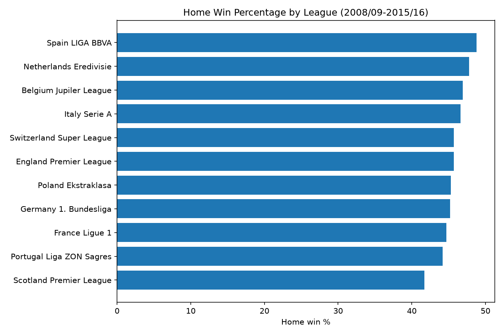
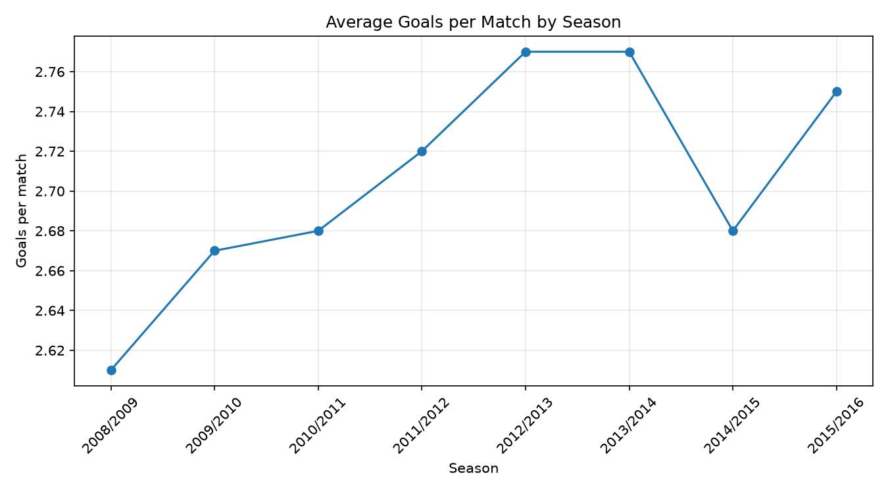

# European Soccer Analysis: Home Advantage and Scoring Trends

SQL + Python analysis of 25,979 matches across 11 European leagues (2008/09 to 2015/16).

## Questions
1. Is home advantage real, and does it change over time?
2. Which leagues score the most goals?
3. Which teams dominate at home?

## Key findings
- Home win percentage declined from 47.1% (2008/09) to 43.9% (2015/16).
- Home win percentage was highest in Spain LIGA BBVA (48.8%) and lowest in the Scotland Premier League (41.7%).
- The Netherlands Eredivisie had the highest average goals per match (3.08).
- Average goals per match stayed between 2.61 and 2.77 across the 8 seasons.
- FC Barcelona (86.2%) and Real Madrid CF (84.9%) had the highest home win rates (min. 100 home matches).

## Possible explanations (hypotheses)

These ideas are not proven by this dataset. They are starting points for further analysis.

- **Declining home advantage (47.1% to 43.9%):** Possible factors include teams adapting better to away games (travel, tactics, preparation) and leagues becoming more competitive. With only 8 seasons, the decline could also be partly random variation.
- **Spain's high home win rate (48.8%):** This can possibly be because of dominant teams like FC Barcelona and Real Madrid CF, which both teams had great seasons with lots of wins most on their home matches (86.2% and 84.9%), which pulls the league average up.
- **Scotland's low home win rate (41.7%):** A league where one or two dominant teams also win away from home would show a smaller gap between home and away results. I would need to check away win rates to test this.
- **High scoring in the Eredivisie:** It may reflect more attacking styles of play or a larger quality gap between top and bottom teams. This dataset cannot confirm either.

## Next steps
- Compare each team's home and away win rates to separate team strength from home advantage.
- Test whether the home advantage trend holds in each league individually.

## Charts

## Tools
SQLite (DB Browser), SQL (JOIN, GROUP BY, CASE, HAVING), Python, pandas, matplotlib, Jupyter

## Files
- `Soccer.sql`: all SQL queries, commented
- `Soccer_Analysis.ipynb`: Python analysis and charts

## Limitations
- Only 8 seasons, so I can't say why home advantage declined, only that it did in this data.
- Team home win rates reflect overall team strength, not just home advantage. Comparing each team's home and away results would isolate the effect.

## Data
[European Soccer Database](https://www.kaggle.com/datasets/hugomathien/soccer) by Hugo Mathien (Kaggle).
